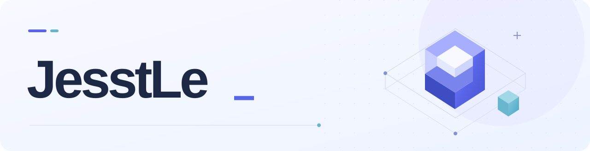

  

## 关于我

你好，我是 **JesstLe**。我在这里分享自己的开发项目，方向涵盖 **AI Agent、知识管理、桌面工具和业务系统**。

从后端运行时到前端界面，这些项目用到了 **Python、TypeScript、Rust 和 C#**。除了维护自己的项目，我也向开源社区提交功能改进与问题修复。

## 公开项目

<table>
  <tr>
    <td width="440" valign="top">
      <h3><a href="https://github.com/JesstLe/NaumiAgent">NaumiAgent</a></h3>
      
面向 AI Agent 的 Python 运行时，提供终端交互与 REST API 服务。

      
<code>Python</code>

    </td>
    <td width="440" valign="top">
      <h3><a href="https://github.com/JesstLe/OpenKnowledge">OpenKnowledge</a></h3>
      
本地知识管理助手，整合文档管理、语义搜索与 RAG 问答。

      
<code>Next.js</code> <code>FastAPI</code> <code>PostgreSQL</code>

    </td>
  </tr>
  <tr>
    <td width="440" valign="top">
      <h3><a href="https://github.com/JesstLe/Task_NeXus_Pro">Task_NeXus_Pro</a></h3>
      
基于 Tauri 的桌面性能工具，覆盖 CPU 调度、进程管理与内存优化。

      
<code>Tauri v2</code> <code>React</code> <code>Rust</code>

    </td>
    <td width="440" valign="top">
      <h3><a href="https://github.com/JesstLe/erp">erp</a></h3>
      
面向门店经营的 ERP，涵盖会员、预约排班、收银与经营报表。

      
<code>C#</code>

    </td>
  </tr>
</table>

## 开源贡献

累计向外部开源项目提交多个 PR；以下五项代表贡献中，**2 项已合并**。

- **[t3code #21654](https://github.com/pingdotgg/t3code/pull/21654) 已合并。**针对 eCryptfs 的 143 字节文件名限制，对超长 ID 使用 SHA-256 摘要标识并兼容旧历史迁移；新增 11 个回归用例，PR 验收中终端管理模块 109 项测试通过。

- **[ECDICT #149](https://github.com/skywind3000/ECDICT/pull/149) 已合并。**修复 Python 3 导出 StarDict 时的 str/bytes 类型错误，补充空词典与多语言导出测试；2 项回归在 Python 2.7、3.12、3.14 通过。

- **[Qwen Code #16115](https://github.com/QwenLM/qwen-code/pull/16115) 已提交，待合并。**修复多图片路径粘贴被错误合并的问题，支持独立引号与转义空格；新增 21 项回归测试，相关输入组件测试 291 项通过。

- **[Google harness2 #164](https://github.com/google-research/harness2/pull/164) 已提交，待合并。**在 Hook 配置校验阶段拦截非字符串 matcher，防止整份 Hook 文件被忽略；补充无效类型、有效值及混合分组回归测试。

- **[new-api #7466](https://github.com/QuantumNous/new-api/pull/7466) 已关闭，未合并。**为密码注册增加独立的按 IP 限流预算，兼容 Redis 与内存路径；超限返回 HTTP 429 与 Retry-After。
